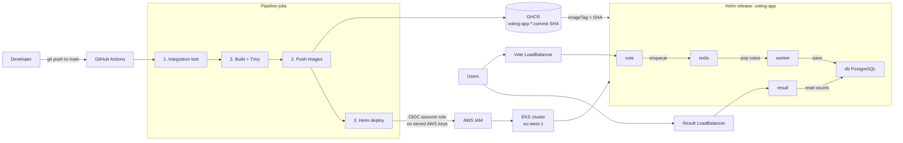

# Architecture

Path from a git push to users hitting the voting app. The Mermaid source of truth is [`architecture.mmd`](architecture.mmd).



GitHub and many Markdown previews render the diagram above automatically.

## Export to PNG

The README expects `docs/architecture.png`. Generate it from the `.mmd` file with [Mermaid CLI](https://github.com/mermaid-js/mermaid-cli):

```bash
npx --yes @mermaid-js/mermaid-cli -i docs/architecture.mmd -o docs/architecture.png
```

Or paste `docs/architecture.mmd` into [mermaid.live](https://mermaid.live), then use **Actions → PNG**. Save the file as `docs/architecture.png`.
